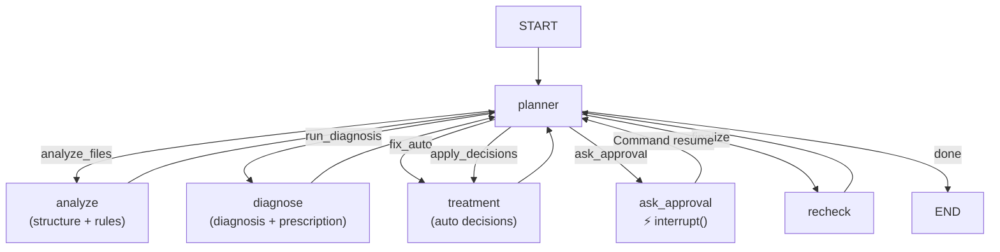

# DataMedic AI — ReAct Agent 재설계

## 1. 문제: 현재 구조가 챗봇인 이유

```
app.py: 버튼 클릭 → structure_node() → rules_node() → diagnosis_node() → prescription_node() → 결과 표시 → Q&A
```

- LangGraph 그래프가 있지만 **app.py가 노드를 직접 순서대로 호출**한다 (파이프라인).
- LLM은 설명·tier 분류만 한다. "다음에 무엇을 할지" 결정하지 않는다.
- 채팅 패널은 진단 완료 후 사용자 질문에 답변하는 Q&A 챗봇이다.
- 진행 경로가 코드에 고정되어 있어, 상황에 따른 분기·루프가 없다.

---

## 2. ReAct 패턴이란

**Reasoning + Acting** — LLM이 루프의 두뇌 역할을 한다.

```
[planner_node]  ←  상태 요약 + 목표 수신
      ↓ 다음 액션 결정 (LLM)
[도구 노드 실행]  →  결과를 state에 기록
      ↓
[planner_node]  ←  결과 관찰 → 다음 액션 결정
      ↓
   ... (루프) ...
      ↓
   done → END
```

LLM이 결정하는 것:
- 어떤 단계를 실행할지
- auto-fix 전에 먼저 집계 규칙(R5~R7)을 실행할지
- 재검진 후 잔여 오류가 있으면 다시 진단을 돌릴지
- approval tier 항목을 사람에게 맡길 시점

---

> **T30 추가(집계)**: 목표에 집계 능력이 있으면 planner가 fix 이후 `run_aggregate`를 선택한다.
>
> **T30 추가**: 그래프 진입점은 `plan` 노드다. 목표를 능력 카탈로그의 Plan으로 해석하고(모호하면 `ask_clarify` interrupt), 이후 모든 노드는 Plan 범위 밖을 실행하지 않는다. 자세한 내용은 `docs/planner_design.md`.

## 3. 새 그래프 구조



**핵심 변화:**
- 모든 실행 노드가 완료 후 반드시 `planner`로 돌아온다.
- `interrupt()`는 `ask_approval_node` 내부에서 호출된다. Human-in-the-loop.
- `planner`는 매 턴마다 전체 상태를 보고 다음 액션을 결정한다.

---

## 4. planner_node 동작

### LLM 판단 흐름
```
입력: goal, agent_phase, issues 요약, agent_loop_count, 이전 액션·이유
출력: {"action": "<액션>", "reason": "<한국어 이유>"}
```

### 폴백 (LLM 미설정 시) — 결정론적 상태 기계
| agent_phase | 조건 | 결정 |
|---|---|---|
| init | — | analyze_files |
| analyzed | — | run_diagnosis |
| diagnosed | approval 없음 | fix_auto |
| diagnosed | approval 있음 | ask_approval |
| approved | — | apply_decisions |
| fixed / applied | — | finalize |
| finalized | 잔여 없음 또는 루프 ≥ 6 | done |
| finalized | 잔여 있음 | run_diagnosis (재진단) |

---

## 5. 상태 변경 (`agent/state.py`)

추가 필드:
```python
agent_action: str        # planner가 결정한 다음 액션
agent_reason: str        # LLM 판단 근거 (화면에 노출)
agent_loop_count: int    # 무한루프 방지 카운터 (≥ 8 → done)
agent_phase: str         # "init"|"analyzed"|"diagnosed"|"fixed"|"approved"|"applied"|"finalized"
```

---

## 6. 변경 파일 목록

| 파일 | 변화 |
|---|---|
| `agent/state.py` | ReAct 필드 4개 추가 |
| `agent/nodes/planner.py` | **신규** — LLM 오케스트레이터 |
| `llm/prompts/agent_plan.md` | **신규** — planner 프롬프트 |
| `agent/graph.py` | `build_react_graph()` 추가, combined step 노드 추가 |
| `app.py` | 노드 직접 호출 → `graph.stream()`, 단계 3개로 단순화 |

---

## 7. app.py 단계 변화

| 구 단계 | 신 단계 |
|---|---|
| ① 업로드 | ① 업로드 (동일) |
| ② 진단 완료 | ② 진단·처방 (Agent 실행 후 중단점) |
| ③ 처방전 | ↑ ② 와 통합 |
| ④ 결과 | ③ 결과 (동일) |

- `② 진단·처방`: Agent가 진단 완료 후 approval 항목이 있으면 `interrupt()`로 멈춤.  
  사용자가 approval 항목을 검토·결정하면 `Command(resume=...)` 으로 재개.
- Agent 실행 중 채팅 패널에 planner의 실시간 판단 근거가 메시지로 표시됨.

---

## 8. Human-in-the-loop 상세

```python
# ask_approval_node 내부
from langgraph.types import interrupt

raw = interrupt({
    "type": "approval_required",
    "issues": [i.model_dump() for i in approval_issues],
})
# raw = app.py가 Command(resume=[...]) 로 넘긴 Decision 목록

# app.py — 재개
from langgraph.types import Command
compiled.stream(Command(resume=decisions_data), config)
```

---

## 9. 설계 원칙 유지 확인

| CLAUDE.md 규칙 | 준수 여부 |
|---|---|
| LLM 출력으로 셀 값 직접 변경 금지 | ✅ fixer.py만 값 변경, planner는 액션만 결정 |
| 입력 파일 수정 금지 | ✅ |
| engine/ 이 llm/ import 금지 | ✅ planner는 agent/ 에 위치 |
| 프롬프트는 llm/prompts/*.md 에만 | ✅ agent_plan.md 신규 추가 |
| 테스트에서 LLM API 호출 금지 | ✅ planner 폴백으로 FakeLLM 없이도 동작 |
