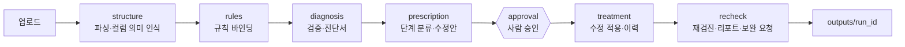
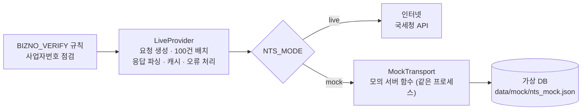

# DataMedic AI

> 여러 기관이 제출한 **Excel·JSON 업무 데이터**의 정합성을 자동으로 **진단 → 처방 → 승인 → 치료 → 재검진**하는 AI Agent

LangGraph 기반 Agent와 Streamlit 화면으로 구성됩니다. 시·군이 제출한 사업 실적 엑셀을 취합하는 담당자가 형식 오류를 정리하는 시간을 줄이고, 폐업 후 지원·중복 수혜·이중 지급·한도 초과 같은 **부적정 지원 의심 건을 근거와 함께 조기 선별**하는 1차 방어선을 목표로 합니다. 부정수급 여부를 판정하지 않으며, 최종 판단은 담당자가 합니다.

## 주요 기능

- **자동 진단** — 필수값 누락, 금액·날짜 표기 혼용, 사업자번호 오류(체크디지트·국세청 휴업/폐업 상태), 중복 수혜·이중 지급·한도 초과, 중복 행
- **단계별 처방** — 오류마다 `auto`(자동) / `approval`(승인) / `request`(보완 요청) 3단계로 분류하고 수정안 제시
- **사람 승인 흐름** — 애매한 수정은 그래프가 중단(interrupt)되어 담당자가 적용·거부·직접 수정을 선택
- **변경 이력 추적** — 모든 수정은 셀 단위 `Change` 레코드로 기록
- **재검진과 보완 요청** — 정제본에 같은 규칙을 다시 돌리고, 남은 오류는 기관별 보완 요청 메일로 생성
- **자연어 목표·질문** — "이번 지원 사업은 한 회사당 한번 가능하며 5천만원 한도가 정해져 있어"처럼 여러 조건이 섞인 문장도 검사별(횟수 제한·합계 한도·이중 지급)로 나눠 읽고, 값마다 원문 근거를 보여 줍니다. 모호하면 선택지로 되묻고, 해석하지 못한 조건은 건너뛰지 않고 어떻게 처리할지 묻습니다. LLM이 읽은 값은 코드가 다시 검증하고 키워드 해석과 대조합니다
- **파일 현황 뷰어** — 파일을 엑셀처럼 셀 단위로 보여 주고(자동 수정·승인 대기·담당자 수정·거절(취소선)·확인 요청 📩), 에이전트가 단계를 마칠 때마다 표가 갱신됩니다. 승인 화면에서 항목을 골라 바로 처리할 수 있습니다
- **내려받기** — 상태 색과 메모가 들어간 엑셀, JSON 입력은 원래 형식의 JSON과 변경 이력 CSV. 사업자번호·기업명을 가린 발표용 파일도 만듭니다
- **메일 발송** — 보완·확인 요청 메일 초안을 기관별로 만들고, 담당자가 확인한 뒤에 발송합니다 (시험 모드, 발송 기록, 중복 발송 방지)
- **표준 서식 자동 인식** — 표준 서식이 없는 파일은 LLM이 컬럼 의미를 추정

## 설계 원칙

1. **LLM은 판단·설명만, 값의 검증·수정은 코드가 한다.** LLM 출력이 셀 값을 직접 바꾸는 경로는 없습니다.
2. **원본 불변.** 입력 파일은 읽기만 하고 결과는 `outputs/<run_id>/`에 새로 씁니다.
3. **모든 변경은 기록한다.** 기록 없이 값을 바꾸지 않습니다.
4. **애매하면 사람 쪽으로.** 불확실하면 `auto`가 아니라 `approval`로 올립니다.
5. **개인정보 보호.** LLM으로 보내는 샘플의 사업자번호·연락처·이메일은 마스킹합니다.

## 동작 흐름



## 프로젝트 구조

```
├── app.py            # Streamlit 화면 (업로드 / 진단서 / 처방전 / 결과)
├── config.py         # 설정 (.env 로드)
├── agent/            # LangGraph 그래프와 노드 (흐름 제어)
├── engine/           # 파싱·규칙·검증·수정·이력 (순수 파이썬, LLM 모름)
│   ├── rules/        #   규칙 구현
│   └── tools/        #   외부 조회 도구 (국세청 사업자 상태 등)
├── llm/              # LLM 클라이언트, 캐시, 프롬프트(prompts/*.md)
├── ui/components/    # 파일 현황 뷰어·실시간 표·메일 발송 화면 (Streamlit 컴포넌트)
├── notify/           # 보완 요청 메일 발송, 기관 주소록
└── data/
    ├── standard/     # 표준 서식(yaml), 코드표·사업 기준표(csv)
    ├── samples/      # 익명화한 가상 샘플 (xlsx 3개)
    └── mock/         # 국세청 모의 응답용 가상 DB
```

계층은 `app.py → ui / agent → engine / llm / notify` 방향으로만 의존하며, `engine/`은 `llm/`·`agent/`를 import하지 않습니다.

## 시작하기

### 요구 사항

- Python 3.11 이상
- Anthropic 또는 OpenAI API 키 (진단 설명·컬럼 의미 추정에 사용)

### 설치

```bash
git clone <저장소 주소>
cd <저장소 폴더>

python -m venv .venv
source .venv/bin/activate        # Windows: .venv\Scripts\activate
pip install -r requirements.txt

cp .env.example .env             # 본인의 API 키를 채워 넣습니다
```

### 환경 변수 (`.env`)

| 변수 | 설명 | 기본값 |
|---|---|---|
| `LLM_PROVIDER` | `claude` 또는 `openai` | `claude` |
| `ANTHROPIC_API_KEY` / `OPENAI_API_KEY` | LLM API 키 | - |
| `LLM_MODEL_CLAUDE` / `LLM_MODEL_OPENAI` | 모델명 | - |
| `NTS_MODE` | 국세청 조회 방식: `mock` / `live` / `off` ([설명](#국세청-사업자-상태조회-연동)) | `mock` |
| `ODCLOUD_API_KEY` | 공공데이터포털 국세청 사업자 상태 조회 키 (`NTS_MODE=live`일 때 필요) | - |
| `SMTP_HOST` / `SMTP_PORT` / `SMTP_USER` / `SMTP_PASSWORD` | 메일 발송 설정 (`SMTP_USER`는 로그인 ID이자 보내는 주소, Gmail은 앱 비밀번호) ([설명](#메일-발송)) | `smtp.gmail.com` / `587` |
| `MAIL_DRY_RUN` | `true`면 메일을 보내지 않고 파일로만 저장 | `true` |
| `DISABLED_RULES` | 끌 규칙 ID를 쉼표로 구분 | 없음 |

> `.env`에는 비밀 값이 들어 있으므로 **절대 커밋하지 않습니다.** (`.gitignore`에 포함)

## 사용법

### 샘플 데이터

`data/samples/`에 3개 시(김해시·진주시·창원시)의 사업 실적 샘플(xlsx)이 들어 있습니다. 모두 **가상 데이터**입니다.

- 기관명은 시 이름을 쓰지만 실적 내용은 가상입니다.
- 수혜기업명은 `A01회사`처럼 일련번호 이름이고, 사업자번호는 체크디지트만 맞춘 가상 번호입니다. 이 3개 파일의 번호 36개를 국세청 API로 조회해 실제 등록 번호와 겹치지 않음을 확인했습니다(2026-10-01).
- 금액·날짜 표기 혼용, 빈 값, 체크디지트 오류 등이 일부러 섞여 있어 진단 기능을 시험할 수 있습니다.

### 웹 화면

```bash
streamlit run app.py
```

1. **업로드** — 파일을 올리고 진단 시작
2. **진행 현황** — 에이전트가 단계를 마칠 때마다 파일 표가 갱신됩니다
3. **진단서** — 오류 요약, 규칙별 건수, 파일별 오류 표 (필터·페이지네이션)
4. **처방전** — 승인이 필요한 항목을 적용 / 거부 / 확인 요청 / 직접 수정 (`📂 파일로 보기`에서 셀을 보며 처리할 수도 있습니다)
5. **결과** — 변경 내역 뷰어, 재검진 결과, 보완·확인 요청 메일 편집·발송, 엑셀·JSON 내려받기

### CLI

```bash
python -m agent.graph --inputs "data/samples/*.xlsx" --auto-approve
```

`--auto-approve`는 승인 대기 항목을 모두 적용합니다.

## 출력물

실행 결과는 `outputs/<run_id>/`(`YYYYMMDD-HHMMSS`)에 저장됩니다.

```
cleaned/<원본파일명>          # 정제본 (원본과 같은 형식, JSON 입력은 JSON)
highlighted/<원본파일명>      # 오류 셀(빨강)·수정 셀(초록) 하이라이트 (엑셀 입력만)
marked/, marked_masked/       # 상태 색·메모가 들어간 엑셀 / 발표용(마스킹) — 결과 화면에서 만들 때 생성
changelog.csv                 # 셀 단위 변경 이력
issues.csv                    # 전체 오류 목록
diagnosis_report.md / .xlsx   # 진단 리포트
requests/<기관명>.json        # 보완 요청 메일 초안
mail_log.csv                  # 메일 발송 기록 (시각·수신자·결과·오류)
report.json                   # 실행 요약
```

## 탐지 규칙

| 규칙 | 대상 | 잡는 것 | 기본 처리 |
|---|---|---|---|
| `BLANK` | 필수 컬럼 | 빈 값, 공백만 있는 값 | 보완 요청 |
| `AMOUNT_NORMALIZE` | 지원금액 | `,`·`원`·`만원`·`억` 등 표기 혼용 → 정수로 통일 | 자동 (모호하면 승인) |
| `DATE_NORMALIZE` | 지원일자 | 비표준 날짜 표기 → `YYYY-MM-DD` | 자동 (모호하면 승인) |
| `BIZNO_VERIFY` | 사업자번호 | 형식·체크디지트 오류, 국세청 상태조회(미등록·휴업·폐업, **폐업 이후 지원**) | 결과별 상이 |
| `MAX_COUNT` | 사업자번호 기준 | 허용 횟수를 넘은 중복 수혜 (목표에 포함될 때) | 확인 요청 |
| `NEAR_DUPLICATE` | 사업자번호+사업명 | 같은 사업의 동일·유사 지급 — 이중 지급 의심 (목표에 포함될 때) | 확인 요청 |
| `SUM_LIMIT` | 사업자번호 기준 | 지원금 합계의 한도 초과 (목표에 포함될 때) | 확인 요청 |
| `DUPLICATE_ROW` | 행 | 완전히 같은 행 (자동 삭제하지 않고 승인을 받음, 목표에 포함될 때) | 승인 |

- 폐업 이후 지원은 폐업일과 지원일자를 비교해 가려냅니다. 체크디지트가 맞지 않는 번호는 오타로 보고 국세청 조회를 하지 않습니다.
- 허용 횟수·한도는 `data/standard/business_master.csv`의 사업 기준표를 따르며, 자연어 목표로 기준을 정할 수도 있습니다. 집계 위반은 위반으로 단정하지 않고 기관에 확인(소명)을 요청하는 것이 기본이며, 확인해 보니 정상이면 `문제 없음`으로 바꿉니다.
- 새 규칙 추가: `engine/rules/`에 클래스를 쓰고 `@register`한 뒤 `engine/semantic.py`에 매핑을 추가합니다.

## 국세청 사업자 상태조회 연동

사업자번호의 휴업·폐업 여부는 공공데이터포털의 국세청 상태조회 API로 확인합니다. `NTS_MODE` 설정으로 조회 방식을 고릅니다.

| `NTS_MODE` | 동작 |
|---|---|
| `mock` (기본) | 실제 서버와 같은 요청·응답 형식의 **모의 서버**를 호출합니다. API 키가 필요 없고 결과가 항상 같습니다. |
| `live` | 실제 국세청 API를 호출합니다. `ODCLOUD_API_KEY`가 필요합니다. |
| `off` | 국세청 조회를 생략하고 체크디지트까지만 검증합니다. |



- **두 모드는 같은 `LiveProvider` 코드를 씁니다.** 요청 생성, 응답 파싱, 100건 배치, 캐시, 오류 처리가 모두 같고, 요청이 가는 곳(네트워크 계층)만 다릅니다. 모의 서버는 별도 프로세스가 아니라 함수 하나입니다.
- **모의 서버는 실제 서버 응답을 기준으로 만들었습니다.** 개발 중 실제 API를 호출해 응답을 캡처하고, 상태코드·Content-Type·응답 필드와 순서·오류 응답이 같은지 비교했습니다.
- **기본값이 mock인 이유:** 실제 사업자 번호 및 기관명을 사용할경우 개인 정보 문제를 발생 시킬 수 있기 때문에 가상 mock을 사용하였습니다.


## 메일 발송

보완 요청과 집계 확인 요청 메일은 **에이전트가 초안만 만들고, 발송은 담당자가 화면에서 직접** 누를 때만 일어납니다.

1. `.env`에 `SMTP_USER`, `SMTP_PASSWORD`, `MAIL_DRY_RUN=false`를 설정합니다. Gmail은 2단계 인증을 켠 뒤 만든 **앱 비밀번호**(공백 없이 16자리)가 필요합니다.
2. 수신자는 기관 주소록에서 기관명으로 찾습니다. `data/standard/org_contacts.example.csv`를 `org_contacts.csv`로 복사해 담당자 메일을 채우세요 (이 파일은 `.gitignore`로 제외됩니다). 못 찾으면 화면에서 직접 입력합니다.
3. 화면 상단에 발송 모드(시험 / 실제)가 표시됩니다. 시험 모드(`MAIL_DRY_RUN=true`, 기본)에서는 메일 내용을 파일로만 저장합니다.
4. 같은 메일은 중복 발송되지 않고, 모든 발송 시도는 `outputs/<run_id>/mail_log.csv`에 남습니다. `SMTP 연결 테스트` 버튼으로 메일을 보내지 않고 계정 설정만 확인할 수 있습니다.

## 기술 스택

Python 3.11 · LangGraph · Streamlit · pandas · openpyxl · pydantic v2 · rapidfuzz · jsonschema · httpx · Anthropic / OpenAI API

## 데이터와 개인정보

저장소에는 **실제 개인정보·기업 정보가 담긴 데이터, 테스트셋, 실행 산출물을 올리지 않습니다.** 포함된 샘플은 모두 익명화한 가상 데이터입니다.
