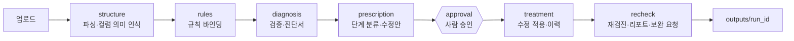

# DataMedic AI

> 여러 기관이 제출한 **Excel·JSON 업무 데이터**의 정합성을 자동으로 **진단 → 처방 → 승인 → 치료 → 재검진**하는 AI Agent

LangGraph 기반 Agent와 Streamlit 화면으로 구성됩니다. 시·군이 제출한 사업 실적 엑셀을 취합하는 담당자가 형식 오류를 정리하는 시간을 줄이고, 폐업 후 지원·중복 수혜·이중 지급·한도 초과 같은 **부적정 지원 의심 건을 근거와 함께 조기 선별**하는 1차 방어선을 목표로 합니다. 부정수급 여부를 판정하지 않으며, 최종 판단은 담당자가 합니다.

## 주요 기능

- **자동 진단** — 날짜·전화번호·사업자번호·금액·코드값 형식, 필수값 누락, 중복 행, 시트 간 합계 불일치, 이상치 등 14종 규칙 + 집계 규칙(중복 수혜·이중 지급·한도 초과)
- **단계별 처방** — 오류마다 `auto`(자동) / `approval`(승인) / `request`(보완 요청) / `info`(참고)로 분류하고 수정안 제시
- **사람 승인 흐름** — 애매한 수정은 그래프가 중단(interrupt)되어 담당자가 적용·거부·직접 수정을 선택
- **변경 이력 추적** — 모든 수정은 셀 단위 `Change` 레코드로 기록
- **재검진과 보완 요청** — 정제본에 같은 규칙을 다시 돌리고, 남은 오류는 기관별 보완 요청 메일로 생성
- **자연어 목표·질문** — "한 기업이 받을 수 있는 게 5천만원인데 넘은 곳 있어?" 같은 질문을 규칙으로 번역해 실행하고, 필요하면 되물음
- **표준 서식 자동 인식** — 표준 서식이 없는 파일은 LLM이 컬럼 의미를 추정

## 설계 원칙

1. **LLM은 판단·설명만, 값의 검증·수정은 코드가 한다.** LLM 출력이 셀 값을 직접 바꾸는 경로는 없습니다.
2. **원본 불변.** 입력 파일은 읽기만 하고 결과는 `outputs/<run_id>/`에 새로 씁니다.
3. **모든 변경은 기록한다.** 기록 없이 값을 바꾸지 않습니다.
4. **애매하면 사람 쪽으로.** 불확실하면 `auto`가 아니라 `approval`로 올립니다.
5. **개인정보 보호.** LLM으로 보내는 샘플의 사업자번호·연락처·이메일은 마스킹합니다.

## 동작 흐름



## 프로젝트 구조

```
├── app.py            # Streamlit 화면 (업로드 / 진단서 / 처방전 / 결과)
├── config.py         # 설정 (.env 로드)
├── agent/            # LangGraph 그래프와 노드 (흐름 제어)
├── engine/           # 파싱·규칙·검증·수정·이력 (순수 파이썬, LLM 모름)
│   ├── rules/        #   규칙 구현
│   └── tools/        #   외부 조회 도구 (국세청 사업자 상태 등)
├── llm/              # LLM 클라이언트, 캐시, 프롬프트(prompts/*.md)
├── notify/           # 보완 요청 메일 발송
├── eval/             # 오류 주입·평가 스크립트
├── data/
│   ├── standard/     # 표준 서식(yaml), 코드표·사업 기준표(csv)
│   └── samples/      # 샘플 데이터 생성 스크립트
├── tests/            # pytest 테스트 (실제 LLM 호출 없음)
└── docs/             # 설계 문서
```

계층은 `app.py → agent → engine / llm / notify` 방향으로만 의존하며, `engine/`은 `llm/`·`agent/`를 import하지 않습니다.

## 시작하기

### 요구 사항

- Python 3.11 이상
- Anthropic 또는 OpenAI API 키 (진단 설명·컬럼 의미 추정에 사용)

### 설치

```bash
git clone <저장소 주소>
cd <저장소 폴더>

python -m venv .venv
source .venv/bin/activate        # Windows: .venv\Scripts\activate
pip install -r requirements.txt

cp .env.example .env             # 본인의 API 키를 채워 넣습니다
```

### 환경 변수 (`.env`)

| 변수 | 설명 | 기본값 |
|---|---|---|
| `LLM_PROVIDER` | `claude` 또는 `openai` | `claude` |
| `ANTHROPIC_API_KEY` / `OPENAI_API_KEY` | LLM API 키 | - |
| `LLM_MODEL_CLAUDE` / `LLM_MODEL_OPENAI` | 모델명 | - |
| `ODCLOUD_API_KEY` | 공공데이터포털 국세청 사업자 상태 조회 키 (선택) | - |
| `SMTP_HOST` / `SMTP_PORT` / `SMTP_USER` / `SMTP_PASSWORD` | 보완 요청 메일 발송 설정 | `smtp.gmail.com` / `587` |
| `MAIL_DRY_RUN` | `true`면 메일을 보내지 않고 파일로만 저장 | `true` |
| `DISABLED_RULES` | 끌 규칙 ID를 쉼표로 구분 | 없음 |

> `.env`에는 비밀 값이 들어 있으므로 **절대 커밋하지 않습니다.** (`.gitignore`에 포함)

## 사용법

### 샘플 데이터 만들기

저장소에는 샘플 파일이 포함되어 있지 않습니다. 스크립트로 가상 데이터를 생성합니다.

```bash
python data/samples/generate_samples.py
```

### 웹 화면

```bash
streamlit run app.py
```

1. **업로드** — 파일을 올리고 진단 시작
2. **진단서** — 오류 요약, 규칙별 건수, 파일별 오류 표 (필터·페이지네이션)
3. **처방전** — 승인이 필요한 항목을 적용 / 거부 / 직접 수정
4. **결과** — 재검진 결과, 변경 이력, 보완 요청 메일 편집·발송, 결과 다운로드

### CLI

```bash
python -m agent.graph --inputs "data/samples/*.xlsx" --auto-approve
```

`--auto-approve`는 승인 대기 항목을 모두 적용합니다.

## 출력물

실행 결과는 `outputs/<run_id>/`(`YYYYMMDD-HHMMSS`)에 저장됩니다.

```
cleaned/<원본파일명>          # 정제본 (원본과 같은 형식)
highlighted/<원본파일명>      # 오류 셀(빨강)·수정 셀(초록) 하이라이트
changelog.csv                 # 셀 단위 변경 이력
issues.csv                    # 전체 오류 목록
diagnosis_report.md / .xlsx   # 진단 리포트
requests/<기관명>.json        # 보완 요청 메일
report.json                   # 실행 요약
```

## 검증 규칙

| 규칙 | 설명 | 기본 처리 |
|---|---|---|
| `TYPE_CONSISTENCY` | 컬럼 다수 타입과 다른 값 | 승인 |
| `REQUIRED` | 필수값 공백 | 보완 요청 |
| `DATE_FORMAT` | ISO 외 날짜 표기 | 자동 |
| `DATE_RANGE` | 범위 밖 일자 | 보완 요청 |
| `BIZNO_CHECKSUM` | 사업자번호 자릿수·체크디지트 | 승인 |
| `PHONE_FORMAT` | 전화번호 하이픈 형식 | 자동 |
| `TEXT_NORMALIZE` | 공백·전각·㈜ 표기 정규화 | 자동 |
| `CODE_VALID` | 코드표에 없는 값 (최근접 코드 제안) | 승인 |
| `NUMERIC_UNIT` | `,`·`원`·`천원` 혼용 | 자동/승인 |
| `DUPLICATE_ROW` | 완전 동일 행 | 승인 |
| `NEAR_DUPLICATE` | 핵심 컬럼 일치·나머지 유사 | 승인 |
| `SUM_MATCH` | 그룹 합계와 요약값 불일치 | 보완 요청 |
| `OUTLIER` | IQR 이탈 또는 평균 대비 5배 초과 | 보완 요청 |
| `JSON_SCHEMA` | JSON 스키마 위반 | 승인 |

집계 규칙(중복 수혜, 이중 지급 의심, 한도 초과)과 상세 명세는 [`RULES.md`](RULES.md)를 참고하세요.

새 규칙 추가: `engine/rules/`에 클래스 작성 → `@register` → `engine/semantic.py` 매핑 추가 → `tests/`에 정상·오류 케이스 각 2개 이상.

## 테스트

```bash
pytest -q
pytest --cov                   # 커버리지
```

테스트에서는 실제 LLM API를 호출하지 않고 `FakeLLM`을 사용합니다.

## 평가

오류를 주입한 테스트셋으로 검출률과 수정 정확도를 측정합니다.

```bash
python eval/inject_errors.py --src data/samples --out data/testset --seed 42
python eval/evaluate.py --testset data/testset --run outputs/<run_id>
```

| 지표 | 목표 |
|---|---|
| 규칙형 오류 검출률 | 95% 이상 |
| 이상치형 오류 검출률 | 70% 이상 |
| 자동 수정 오수정률 | 3% 이하 |
| 수정안 적중률 | 80% 이상 |
| 자동 처리율 | 60% 이상 |

## 기술 스택

Python 3.11 · LangGraph · Streamlit · pandas · openpyxl · pydantic v2 · rapidfuzz · jsonschema · Anthropic / OpenAI API

## 문서

- [`docs/DESIGN.md`](docs/DESIGN.md) — 전체 설계 문서 (데이터 모델, 노드 명세, 작업 목록)
- [`RULES.md`](RULES.md) — 탐지 규칙 상세 명세
- [`docs/planner_design.md`](docs/planner_design.md) — 목표 해석(Plan) 범위 가드 설계
- [`ODCLOUD.md`](ODCLOUD.md) — 국세청 사업자 상태 조회 연동
- [`REACT_AGENT_DESIGN.md`](REACT_AGENT_DESIGN.md) — ReAct 방식 Agent 설계

## 데이터와 개인정보

저장소에는 **개인정보가 포함된 샘플·테스트셋·산출물을 올리지 않습니다.** 샘플은 `generate_samples.py`로 만든 가상 데이터이며, 기관 주소록은 `data/standard/org_contacts.example.csv` 형식을 참고해 직접 작성합니다.
