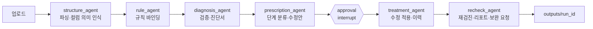

# DataMedic AI — 설계 문서

> 업무 데이터(Excel·JSON) 정합성 자동 진단·복구·검증 AI Agent
> 이 문서는 **무엇을, 어떤 구조로 만드는지**를 정의한다. 구현은 14장 작업 목록 순서대로 진행한다.

---

## 1. 한 문장 요약

여러 기관이 제출한 엑셀·JSON 파일을 받아 **진단 → 처방 → (승인) → 치료 → 재검진**하고, 정제본·셀 단위 변경 이력·진단 리포트·보완 요청을 출력하는 LangGraph 기반 Agent.

## 2. 설계 원칙 (모든 코드에 적용)

1. **LLM은 판단·설명만, 값의 검증·수정은 코드가 한다.** LLM 출력이 셀 값을 직접 바꾸는 경로는 존재하면 안 된다.
2. **원본 불변.** 입력 파일은 읽기만 한다. 모든 결과는 `outputs/<run_id>/`에 새로 쓴다.
3. **모든 변경은 `Change` 레코드로 남는다.** 기록 없이 값을 바꾸는 함수는 만들지 않는다.
4. **애매하면 사람 쪽으로.** 처리 단계가 불확실하면 `auto`가 아니라 `approval`, `approval`이 불확실하면 `request`.
5. **결정론 우선.** LLM 호출은 `temperature=0`, 동일 입력은 캐시해서 같은 결과를 낸다.
6. **모듈 간에는 7장의 데이터 모델로만 통신한다.** DataFrame을 모듈 밖으로 날것으로 넘기지 않는다(엔진 내부 제외).

## 3. MVP 범위

| 포함 | 제외 (추후 확장) |
|---|---|
| `.xlsx` (헤더 1행, 병합 셀 없는 표) | 병합 셀, 다중 헤더, 수식 재계산 |
| `.json` (객체 배열) | 중첩 JSON의 깊은 구조 |
| 한 번에 여러 파일(기관별 1파일) 업로드 | 대용량(파일당 1만 행 초과) |
| 규칙 템플릿 14종 | 사용자 정의 규칙 편집 UI |
| 보완 요청 메일 발송 | 결재 시스템 연동 |

## 4. 전체 구조



**계층 구조** (위가 아래를 호출, 역방향 import 금지)

```
app.py (Streamlit)
  └─ agent/        LangGraph 그래프와 노드 — 흐름 제어만
       ├─ engine/  파싱·규칙·검증·수정·이력 — 순수 파이썬, LLM 모름
       ├─ llm/     LLM 호출·프롬프트 — 엔진 모름
       └─ notify/  메일
```

`engine/`은 LLM 없이 단독으로 테스트 가능해야 한다.

## 5. 디렉터리

```
datamedic/
├── app.py
├── agent/
│   ├── state.py            # GraphState 정의
│   ├── graph.py            # 그래프 조립, 체크포인터, CLI 진입점
│   └── nodes/
│       ├── structure.py
│       ├── rules.py
│       ├── diagnosis.py
│       ├── prescription.py
│       ├── treatment.py
│       └── recheck.py
├── engine/
│   ├── models.py           # 7장 데이터 모델 (pydantic)
│   ├── parser.py           # 파일 → Dataset
│   ├── semantic.py         # 의미 타입 → 기본 규칙 매핑
│   ├── rules/
│   │   ├── base.py         # Rule 추상 클래스, 레지스트리
│   │   ├── format_rules.py # DATE_FORMAT, PHONE_FORMAT, TEXT_NORMALIZE
│   │   ├── value_rules.py  # REQUIRED, DATE_RANGE, BIZNO_CHECKSUM, CODE_VALID, NUMERIC_UNIT
│   │   ├── row_rules.py    # DUPLICATE_ROW, NEAR_DUPLICATE
│   │   ├── table_rules.py  # SUM_MATCH, OUTLIER, TYPE_CONSISTENCY
│   │   └── json_rules.py   # JSON_SCHEMA
│   ├── validator.py        # 바인딩 실행 → Issue 목록
│   ├── fixer.py            # 결정에 따라 수정 → Change 목록
│   ├── exporter.py         # 정제본·이력·리포트 파일 쓰기
│   └── codebook.py         # 코드표 로드·유사 코드 검색
├── llm/
│   ├── client.py           # complete_json(), 캐시, 재시도
│   └── prompts/
│       ├── column_semantics.md
│       ├── relation_hints.md
│       ├── explain_issue.md
│       └── request_mail.md
├── notify/mailer.py
├── config.py               # 경로, 임계값, 모델명 (.env 로드)
├── data/
│   ├── standard/           # 표준 서식 정의(yaml), 코드표(csv)
│   ├── samples/            # 깨끗한 샘플
│   └── testset/            # 오류 주입본 + answer.json
├── eval/
│   ├── inject_errors.py
│   └── evaluate.py
├── tests/
│   ├── fixtures/           # 작은 테스트용 xlsx/json
│   └── test_*.py
├── outputs/                # 실행 결과 (git 제외)
├── CLAUDE.md
├── requirements.txt
└── .env.example
```

## 6. 실증 시나리오 데이터

경남 도내 시·군 20곳이 같은 서식의 **사업 실적 엑셀**을 제출하고, 담당자가 취합하는 상황.

`data/standard/performance.yaml` 표준 서식 예시

```yaml
name: 시군_사업실적
sheets:
  실적:
    columns:
      - {name: 기관명,       type: org_name, required: true}
      - {name: 사업코드,     type: code,     required: true, codebook: business_codes.csv}
      - {name: 사업명,       type: text,     required: true}
      - {name: 수혜기업명,   type: org_name, required: true}
      - {name: 사업자번호,   type: biz_no,   required: true}
      - {name: 지원일자,     type: date,     required: true, range: [2026-01-01, 2026-12-31]}
      - {name: 지원금액,     type: amount,   required: true, unit: 원}
      - {name: 담당자연락처, type: phone,    required: false}
  요약:
    columns:
      - {name: 사업코드,     type: code,   required: true}
      - {name: 지원건수,     type: count,  required: true}
      - {name: 지원금액합계, type: amount, required: true}
relations:
  - {rule: SUM_MATCH, source: 실적.지원금액, group_by: 사업코드, agg: sum,   target: 요약.지원금액합계}
  - {rule: SUM_MATCH, source: 실적.사업코드, group_by: 사업코드, agg: count, target: 요약.지원건수}
```

표준 서식이 있으면 그대로 쓰고, **없는 새 파일은 LLM이 컬럼 의미를 추정**해 같은 구조의 프로필을 만든다(8.1).

## 7. 데이터 모델 (`engine/models.py`)

모든 모델은 pydantic `BaseModel`. 필드명을 바꾸면 이 문서도 같이 수정한다.

```python
SemanticType = Literal["org_name", "biz_no", "date", "amount", "count",
                       "phone", "email", "code", "text", "unknown"]
Tier = Literal["auto", "approval", "request", "info"]  # info=참고 정보, 자동처리 없음
ErrorKind = Literal["rule", "outlier"]

class CellRef(BaseModel):
    file: str            # 원본 파일명
    sheet: str           # JSON은 "root"
    row: int             # 엑셀 기준 행 번호 (헤더=1, 첫 데이터=2)
    column: str          # 컬럼명
    @property
    def a1(self) -> str: ...   # "실적!G12"

class ColumnProfile(BaseModel):
    name: str
    semantic_type: SemanticType
    required: bool = False
    confidence: float = 1.0      # 표준 서식이면 1.0, LLM 추정이면 그 값
    params: dict = {}            # codebook, range, unit 등

class SheetProfile(BaseModel):
    file: str
    sheet: str
    columns: list[ColumnProfile]
    row_count: int

class RuleBinding(BaseModel):
    rule_id: str
    targets: list[str]           # "실적.지원금액" 형식
    params: dict = {}
    source: Literal["standard", "semantic_default", "llm_hint"]

class Issue(BaseModel):
    issue_id: str                # "E-0001"
    ref: CellRef | None          # 테이블 단위 오류는 대표 셀 또는 None
    rule_id: str
    kind: ErrorKind
    value: str | None
    message: str                 # 코드가 만든 짧은 사실 설명
    explanation: str | None = None   # LLM이 만든 사람용 설명
    tier: Tier
    suggestion: str | None = None
    confidence: float = 1.0

class Decision(BaseModel):
    issue_id: str
    action: Literal["apply", "reject", "edit", "request"]
    value: str | None = None     # edit일 때 사람이 입력한 값
    decided_by: Literal["system", "operator"] = "operator"

class Change(BaseModel):
    change_id: str               # "C-0001"
    issue_id: str
    ref: CellRef
    before: str | None
    after: str | None            # 행 삭제는 None
    tier: Tier
    decided_by: Literal["system", "operator"]
    timestamp: datetime

class RequestItem(BaseModel):
    org: str                     # 기관명 (파일 단위)
    issues: list[str]            # issue_id 목록
    subject: str
    body: str
    to: str | None = None
    sent: bool = False

class PlanStep(BaseModel):          # T30: 목표 해석 계획의 한 단계
    capability: str                # engine/planning.py 카탈로그 ID
    label: str
    status: Literal["run", "dependency", "skipped"]
    reason: str


class Plan(BaseModel):             # T30: 범위 가드의 유일한 기준 (docs/planner_design.md)
    goal: str
    status: Literal["ready", "needs_clarification"]
    steps: list[PlanStep] = []
    question: str | None = None
    options: list[dict] = []
    delete_intent: bool = False
    source: Literal["llm", "keyword", "full", "user"] = "keyword"


class RunReport(BaseModel):
    run_id: str
    files: list[str]
    issue_counts: dict[str, int]     # rule_id별
    tier_counts: dict[str, int]      # tier별
    recheck_passed: bool
    remaining_issues: list[str]
```

**Dataset** (엔진 내부 전용)

```python
class Dataset:
    tables: dict[tuple[str, str], pd.DataFrame]   # (file, sheet) → 모든 값 str로 읽은 DF
    def cell(self, ref: CellRef) -> str | None: ...
    def set_cell(self, ref: CellRef, value: str | None) -> None: ...  # fixer만 호출
    def drop_row(self, file: str, sheet: str, row: int) -> None: ...  # fixer만 호출
    def copy(self) -> "Dataset": ...
```

- 파서는 **모든 값을 문자열로** 읽는다(`dtype=str`, 엑셀 날짜 일련번호는 ISO 문자열로 변환). 타입 해석은 규칙이 한다.
- 행 번호는 원본 기준으로 고정한다(행 삭제 후에도 다른 행의 번호가 밀리지 않도록 원본 행 번호 컬럼 `_row`를 보관).

## 8. 에이전트 노드 명세

그래프 상태 (`agent/state.py`)

```python
class GraphState(TypedDict):
    run_id: str
    input_paths: list[str]
    dataset: Dataset
    profiles: list[SheetProfile]
    bindings: list[RuleBinding]
    issues: list[Issue]
    decisions: list[Decision]      # approval 단계에서 UI가 채움
    cleaned: Dataset | None
    changes: list[Change]
    requests: list[RequestItem]
    report: RunReport | None
```

### 8.1 structure_agent
- 입력 `input_paths` → 출력 `dataset`, `profiles`
- `parser.load_files()`로 Dataset 생성
- 표준 서식과 **컬럼명이 80% 이상 일치**하면 표준 프로필 사용
- 아니면 LLM `column_semantics` 호출: 헤더 + **마스킹된 샘플 5행** → 컬럼별 `semantic_type`, `confidence`
- confidence < 0.6 컬럼은 `unknown` 처리 (TYPE_CONSISTENCY만 적용)

### 8.2 rule_agent
- 입력 `profiles` → 출력 `bindings`
- 1순위: 표준 서식의 `required`·`relations`
- 2순위: `engine/semantic.py`의 **의미 타입 → 기본 규칙 매핑** (코드, LLM 아님)

  | semantic_type | 기본 규칙 |
  |---|---|
  | 모든 컬럼 | TYPE_CONSISTENCY, REQUIRED(필수일 때) |
  | date | DATE_FORMAT, DATE_RANGE(범위 있을 때) |
  | biz_no | BIZNO_CHECKSUM |
  | phone | PHONE_FORMAT |
  | org_name, text | TEXT_NORMALIZE |
  | code | CODE_VALID(코드표 있을 때) |
  | amount, count | NUMERIC_UNIT, OUTLIER |
  | 테이블 단위 | DUPLICATE_ROW, NEAR_DUPLICATE |

- 3순위: 표준 서식이 없을 때만 LLM `relation_hints`로 시트 간 합계 관계 **후보**를 받고, 코드가 실제 합계를 계산해 대부분 성립하는 관계만 채택

### 8.3 diagnosis_agent
- 입력 `dataset`, `bindings` → 출력 `issues`
- `validator.run()` 실행
- 같은 rule_id·같은 원인의 Issue는 **대표 1건만 LLM `explain_issue`로 설명**하고 나머지는 복사 (호출 수 절감)

### 8.4 prescription_agent
- 입력 `issues` → 출력 `issues` (tier, suggestion 확정)
- 규칙의 `default_tier`에서 시작해 아래 조건이면 한 단계 올림
  - 규칙이 "의미가 달라질 수 있음"으로 판단한 경우
  - 같은 셀에 규칙 2개 이상이 서로 다른 수정을 제안하는 경우
- suggestion은 코드 우선 (예: CODE_VALID → `codebook.nearest()`), 코드로 못 만들 때만 LLM

### 8.5 approval (interrupt)
- `auto` Issue → `Decision(action="apply", decided_by="system")` 자동 생성
- `request` Issue → `Decision(action="request", decided_by="system")`
- `approval` Issue가 있으면 그래프를 **중단**하고 UI에 넘김 → UI가 `decisions`를 채운 뒤 재개 (LangGraph checkpointer + interrupt)
- CLI 실행 시에는 `--auto-approve` 옵션으로 approval을 전부 적용하거나 전부 거부

### 8.6 treatment_agent
- 입력 `dataset`, `issues`, `decisions` → 출력 `cleaned`, `changes`
- `fixer.apply()`만 호출. **LLM 호출 금지.**
- `apply` → 규칙의 `fix()` 또는 suggestion 적용, `edit` → 사람이 입력한 값 적용, `reject`/`request` → 변경 없음

### 8.7 recheck_agent
- `cleaned`에 **동일 bindings로 validator 재실행**
- 남은 오류 중 request 대상은 기관(파일)별로 묶어 LLM `request_mail`로 본문 생성 → `mailer.send()` (`MAIL_DRY_RUN=true`면 파일로만 저장)
- `exporter`로 결과 저장, `RunReport` 생성

## 9. 규칙 엔진 (`engine/rules/`)

```python
class Rule(ABC):
    rule_id: ClassVar[str]
    kind: ClassVar[ErrorKind] = "rule"
    default_tier: ClassVar[Tier]
    scope: ClassVar[Literal["cell", "row", "table", "cross_sheet"]]

    @abstractmethod
    def check(self, ds: Dataset, binding: RuleBinding, ctx: RuleContext) -> list[Issue]: ...

    def fix(self, value: str | None, issue: Issue) -> str | None:
        """결정론적 변환만 허용. 고칠 수 없으면 NotFixable 예외."""
        raise NotFixable

REGISTRY: dict[str, type[Rule]] = {}
def register(cls): REGISTRY[cls.rule_id] = cls; return cls
```

| rule_id | scope | default_tier | check 요지 | fix |
|---|---|---|---|---|
| TYPE_CONSISTENCY | cell | approval | 컬럼 다수 타입과 다른 값 | ✗ |
| REQUIRED | cell | request | 필수값 공백 | ✗ |
| DATE_FORMAT | cell | auto | ISO 외 날짜 표기 | 파싱 가능하면 `YYYY-MM-DD`, 모호하면 approval |
| DATE_RANGE | cell | request | 범위 밖 일자 | ✗ |
| BIZNO_CHECKSUM | cell | approval | 10자리·체크디지트 | 하이픈 형식 통일만 auto |
| PHONE_FORMAT | cell | auto | 하이픈 형식 불일치 | `0XX-XXXX-XXXX` |
| TEXT_NORMALIZE | cell | auto | 앞뒤 공백, 전각, ㈜ 표기 | 정규화 |
| CODE_VALID | cell | approval | 코드표에 없음 | ✗ (suggestion = 최근접 코드) |
| NUMERIC_UNIT | cell | approval | `,`·`원`·`천원` 혼용 | 기호 제거만 auto, 단위 환산은 approval |
| DUPLICATE_ROW | row | auto | 완전 동일 행 | 두 번째 이후 행 삭제 |
| NEAR_DUPLICATE | row | approval | 핵심 컬럼 일치, 나머지 유사 | ✗ |
| SUM_MATCH | cross_sheet | request | 그룹 합계 ≠ 요약값 | ✗ |
| OUTLIER | table | request | IQR 이탈 또는 기관 평균 대비 5배 초과 | ✗ (`kind="outlier"`) |
| JSON_SCHEMA | cell | approval | jsonschema 위반 | ✗ |

**규칙 추가 방법**: 해당 파일에 클래스 작성 → `@register` → `semantic.py` 매핑 추가 → `tests/test_rules_<그룹>.py`에 정상·오류 케이스 각 2개 이상.

## 10. LLM 계층 (`llm/`)

```python
def complete_json(prompt_name: str, variables: dict, schema: type[BaseModel]) -> BaseModel
```

- 프롬프트는 `llm/prompts/*.md` 파일로 관리, 코드에 문자열로 박지 않는다
- 응답은 **JSON만** 요청하고 pydantic으로 검증, 실패 시 2회 재시도 후 안전한 기본값 반환(예: `unknown`)
- 캐시 키 = 프롬프트명 + 변수 해시 → `outputs/.cache/`
- `LLM_PROVIDER=claude|openai`로 전환, 기본 claude
- 테스트에서는 `FakeLLM`으로 대체 가능하게 의존성 주입
- 샘플 행 전송 시 사업자번호·연락처·이메일은 **마스킹** (`123-45-*****`)

| 프롬프트 | 입력 | 출력 스키마 |
|---|---|---|
| column_semantics | 헤더, 마스킹 샘플 5행 | `[{column, semantic_type, confidence}]` |
| relation_hints | 시트별 컬럼 프로필 | `[{source, group_by, agg, target}]` |
| explain_issue | rule_id, value, message | `{explanation}` 1~2문장 한국어 |
| request_mail | 기관명, 오류 목록 | `{subject, body}` 공문체 |

## 11. 화면 (`app.py`, Streamlit)

탭 4개, `st.session_state`에 `run_id`와 그래프 thread_id 보관.

| 탭 | 내용 |
|---|---|
| ① 업로드 | 다중 파일 업로드, 표준 서식 선택(또는 자동 인식), [진단 시작] |
| ② 진단서 | 요약 카드(총 오류 / auto / approval / request), 규칙별 건수 차트, 파일별 오류 표 |
| ③ 처방전 | approval 목록: 셀 위치, 원래 값, 제안 값, 근거 → 행마다 적용/거부/직접 수정, [승인 후 치료] |
| ④ 결과 | 재검진 결과, 변경 이력 표, 보완 요청 미리보기·발송 상태, 결과 다운로드 |

## 12. 출력물 (`outputs/<run_id>/`)

```
cleaned/<원본파일명>          # 정제본 (원본과 같은 형식)
highlighted/<원본파일명>      # 오류 셀(빨간)·수정 셀(초록) 하이라이트 엑셀 [T15]
changelog.csv                 # Change 전체
issues.csv                    # Issue 전체 (최종 상태 포함)
diagnosis_report.md           # 진단서 (요약 + 규칙별 + 파일별)
diagnosis_report.xlsx         # 강화 진단 리포트 (요약·전체목록·파일별 시트) [T21]
requests/<기관명>.json        # 보완 요청 (subject, body, sent)
report.json                   # RunReport
```

## 13. 평가 (`eval/`)

- `inject_errors.py --src data/samples --out data/testset --seed 42`
  - 규칙형 약 200개, 이상치형 약 50개 주입, `answer.json`에 `{ref, rule_id, original, injected}` 저장
  - 오류 유형은 9장 규칙 기준, 유형 안의 변형(날짜 표기 방식 등)은 무작위
- `evaluate.py --testset data/testset --run outputs/<run_id>`
  - 출력 지표와 목표

  | 지표 | 목표 |
  |---|---|
  | 규칙형 오류 검출률 | 95% 이상 |
  | 이상치형 오류 검출률 | 70% 이상 |
  | 자동 수정 오수정률 | 3% 이하 |
  | 수정안 적중률 | 80% 이상 |
  | 자동 처리율 | 60% 이상 |
  | 진단 처리 속도 | 파일 20개 5분 이내 |

## 14. 작업 목록 (구현 순서)

각 작업은 Claude Code 세션 하나 분량이다. 완료 기준을 통과하면 체크한다.

| ID | 작업 | 담당 | 의존 | 완료 기준 |
|---|---|---|---|---|
| T01 | 프로젝트 골격, config, requirements, `.env.example` | B | - | `pytest` 실행됨 |
| T02 | `engine/models.py` 전체 | B | T01 | 모델 생성·직렬화 테스트 통과 |
| T03 | 표준 서식 yaml, 코드표, 샘플 20개 생성 스크립트 | B | T02 | `data/samples/` 20개 파일 |
| T04 | `parser.py` + `Dataset` | B | T02 | xlsx·json 픽스처 로드, 행 번호 매핑 테스트 |
| T05 | 규칙 base + format_rules | B | T04 | 규칙별 테스트 통과 |
| T06 | value/row/table/json 규칙 | B | T05 | 14개 규칙 테스트 통과 |
| T07 | `validator`, `fixer`, `exporter`, `semantic.py`, `codebook.py` | B | T06 | 오류 넣은 샘플 → 정제본·이력 생성 |
| T08 | `eval/inject_errors.py`, `evaluate.py` | A | T03 | 테스트셋 + answer.json, 평가 스크립트 동작 |
| T09 | `llm/client.py` + 프롬프트 4종 | A | T02 | FakeLLM 테스트 + 실제 호출 1회 확인 |
| T10 | `agent/state.py`, 노드 6개, `graph.py` | A | T07, T09 | CLI end-to-end, approval에서 멈춤·재개 |
| T11 | `app.py` 4개 탭 | A | T10 | 업로드→승인→다운로드 클릭으로 완주 |
| T12 | `notify/mailer.py` + recheck 연동 | B | T10 | 테스트 주소로 메일 수신 |
| T13 | 평가 실행·튜닝 | A | T08, T10 | 13장 목표 달성 여부 표 |
| T14 | AWS 배포 | B | T11 | 외부 URL 접속 |

- [x] T01  - [x] T02  - [x] T03  - [x] T04  - [x] T05  - [x] T06  - [x] T07
- [x] T08  - [x] T09  - [x] T10  - [x] T11  - [x] T12  - [x] T13  - [x] T14

A = 김홍민, B = 우대원. A는 T02가 끝나면 모델만 보고 T09·T10을 가짜 Issue로 먼저 개발한다. 블라인드 평가를 위해 **B는 `data/testset/`과 `eval/inject_errors.py`를 열람하지 않는다.**

### 보강 작업 (T15~T26)

| ID | 작업 | 의존 | 완료 기준 |
|---|---|---|---|
| T15 | `exporter.py` — 오류 하이라이트 엑셀 출력 (`save_highlighted`): 오류 셀 빨간색, 수정 셀 초록색 | T07 | pytest + 색상 셀 확인 |
| T16 | `app.py` 진단서 탭 — tier·rule_id·파일 멀티셀렉트 필터 + 페이지네이션 | T11 | 필터 동작 확인 |
| T17 | `app.py` 사이드바 — 실행 이력 (outputs/ 스캔, 과거 run_id 불러오기) | T11 | 이전 run_id 선택 후 결과 표시 |
| T18 | `structure_node` — 복수 표준 서식 yaml 지원 (standard/ 전체 스캔, 업로드 파일과 최적 매칭) | T10 | yaml 2개 이상으로 테스트 통과 |
| T19 | `config.py` + `validator.py` — 규칙 on/off (`disabled_rules` .env 설정) | T06 | 비활성 규칙 스킵 테스트 |
| T20 | `app.py` — 진단 진행 단계 실시간 표시 (`st.status` 노드별 체크) | T11 | 업로드→진단 중 단계 표시 확인 |
| T21 | `exporter.py` — 강화 진단 리포트 xlsx (파일별·규칙별 시트, 오류 목록 포함) | T15 | xlsx 파일 생성 + 시트 구조 테스트 |
| T22 | `llm/client.py` — 캐시 만료 TTL + 캐시 히트율 로깅 | T09 | TTL 만료 후 재호출 + 히트율 출력 |
| T23 | `app.py` 탭 4 — 보완 요청 메일 내용 인라인 편집·발송 UI | T12 | 편집 후 발송 버튼 동작 확인 |
| T24 | `Dockerfile` + `docker-compose.yml` — 컨테이너 단일 명령 실행 | T14 | `docker compose up` 후 Streamlit 접속 |
| T25 | 테스트 보강 — exporter·mailer·app 통합 테스트, 커버리지 90% 이상 | T21 | `pytest --cov` 90% 이상 |
| T26 | E2E 최종 검증 + README 전체 정합성 갱신 | T25 | 샘플 20개 자동 실행 → 목표 지표 달성 |
| T27 | 담당자연락처 제거, 기관 주소록, 사업자번호 표시 마스킹 (16.13, RULES R-08~R-10) | B | - | 화면·로그·프롬프트에 원본 번호 없음 | 안전·윤리 |
| T28 | 집계 규칙 R5 중복 수혜·R6 이중 지급 의심·R7 한도 초과 + 사업 기준표 (16.13, RULES R-11~R-13) | B | T27 | 기준표만으로 R5·R7 자동 실행, 테스트 통과 | Reasoning·Tool |
| T30 | 목표(Plan) 범위 가드: plan 노드·능력 카탈로그·되묻기·DUPLICATE_ROW 승인 잠금·국세청 호출 차단 (`docs/planner_design.md`) | - | T26 | 목표에 없는 규칙·국세청 호출·자동 삭제 0건, `tests/test_t30_plan_scope.py` 통과 | Goal·Planning |
| T29 | 자연어 질문 → 집계 규칙 노드와 화면 (T30 이후 채팅 패널 없이 목표 입력→그래프 `aggregate` 단계로 통합) (16.13, RULES 8장, R-14~R-15) | A | T28 | 시연 질문 3개가 되묻기·확인·실행·저장까지 완주 | Goal·Memory |

- [x] T15  - [x] T16  - [x] T17  - [x] T18  - [x] T19  - [x] T20
- [x] T21  - [x] T22  - [x] T23  - [x] T24  - [x] T25  - [x] T26
- [ ] T27  - [ ] T28  - [ ] T29  - [x] T30

## 15. 실행

```bash
python -m venv .venv && source .venv/bin/activate
pip install -r requirements.txt
cp .env.example .env
pytest -q
python -m agent.graph --inputs "data/samples/*.xlsx" --auto-approve
streamlit run app.py
python eval/evaluate.py --testset data/testset --run outputs/<run_id>
```

`.env.example`

```
LLM_PROVIDER=claude
ANTHROPIC_API_KEY=
OPENAI_API_KEY=
LLM_MODEL_CLAUDE=
LLM_MODEL_OPENAI=
SMTP_HOST=smtp.gmail.com
SMTP_PORT=587
SMTP_USER=
SMTP_PASSWORD=
MAIL_DRY_RUN=true
```

> 대회 규정상 공식 개발기간 이전의 사전 개발은 금지된다. 구현은 개발기간 시작 후 진행한다.

## 16. 상세 설계 보강 이력

### 16.13 시나리오 확정과 집계 규칙·자연어 질문 (T27~T29)

**시나리오**: 도·협회 보조사업 담당자가 시·군이 제출한 기업별 사업실적을 취합할 때, 형식 오류 정리 시간을 줄이고 **폐업 후 지원·중복 수혜·이중 지급·한도 초과 같은 부적정 지원 의심 건을 근거와 함께 조기 선별**하는 1차 방어선. 부정수급 판정은 하지 않으며 최종 판단은 담당자가 한다.

**상세 명세는 `RULES.md`가 기준이다** (README 9장보다 우선).
- 탐지 규칙 R1~R7, 표시 마스킹·가상 데이터 원칙: RULES.md 0장~R7
- 사업 기준표 `business_master.csv`, 기관 주소록 `org_contacts.csv`: RULES.md "R5~R7 기준 데이터"
- 자연어 질문 흐름(번역 → 검증 → 되묻기 → 확인 → 실행 → 요약 → 저장): RULES.md 8장

**그래프 연결**: 자연어 질문은 메인 진단 그래프가 끝난 뒤(R1~R4 정규화 완료본 기준) 별도 서브그래프로 실행한다. 저장된 사용자 기준(`data/memory/rules.json`)은 다음 실행의 rule_agent가 기준표 규칙과 함께 바인딩한다.

**화면**: 진단서 탭(또는 단계) 아래에 "Agent에게 질문하기" 입력창과 예시 질문 버튼 3개. 결과는 요약 문장 + 근거 표 + [보완 요청에 추가] [이 기준 저장하기].

**시연 시나리오 반영 (16.10 수정)**: 1:00~1:40 구간에 "한 기업이 받을 수 있는 게 5천만원인데 넘은 곳 있어?" 질문 → "사업별인가요, 합산인가요?" 되묻기 → 결과 → [이 기준 저장하기] 장면을 넣는다.
